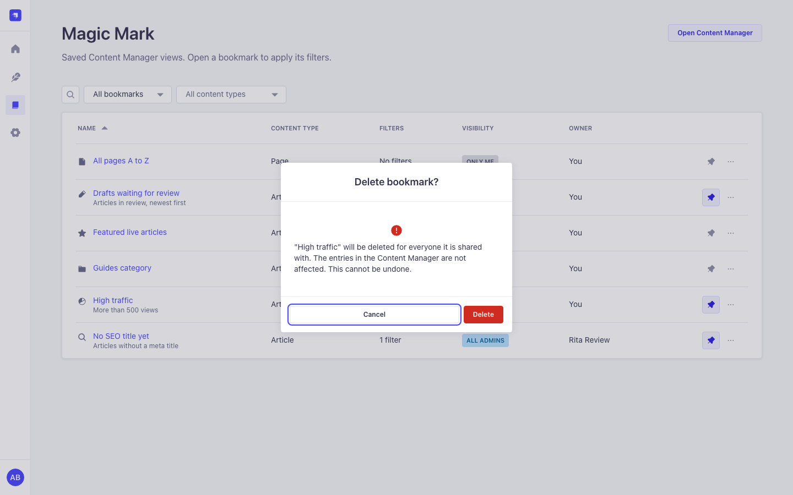

<p align="center">
  
</p>

# Magic Mark

**Saved views for the Strapi 5 Content Manager.** Filter a list once, save it as a bookmark and
get back to exactly that list with one click. Share bookmarks with roles or single admin users,
pin your favourites to the Strapi homepage, and build filters the native filter bar cannot
express ("any condition", "is one of", "is between", relation and component fields).

Free and open source under the MIT license. No license key, no limits, no telemetry and no calls
to external servers.

[](https://www.npmjs.com/package/strapi-plugin-magic-mark)
[](https://www.npmjs.com/package/strapi-plugin-magic-mark)
[](https://github.com/Schero94/Magicmark/actions/workflows/test.yml)
[](#compatibility)
[](./LICENSE)

Website: [schero94.github.io/Magicmark](https://schero94.github.io/Magicmark/) ·
npm: [strapi-plugin-magic-mark](https://www.npmjs.com/package/strapi-plugin-magic-mark) ·
Issues: [github.com/Schero94/Magicmark/issues](https://github.com/Schero94/Magicmark/issues)


## Contents

- [Why Magic Mark](#why-magic-mark)
- [Features](#features)
- [Quick start (1 minute)](#quick-start-1-minute)
- [Screenshots](#screenshots)
- [How it works](#how-it-works)
- [Configuration](#configuration)
- [Permissions](#permissions)
- [Examples](#examples)
- [Admin API](#admin-api)
- [Security and privacy](#security-and-privacy)
- [Performance](#performance)
- [Running several instances (Railway replicas, pm2 cluster)](#running-several-instances-railway-replicas-pm2-cluster)
- [Compatibility](#compatibility)
- [Upgrading from 3.x](#upgrading-from-3x)
- [Troubleshooting](#troubleshooting)
- [FAQ](#faq)
- [Development and tests](#development-and-tests)
- [Contributing and support](#contributing-and-support)
- [License](#license)

## Why Magic Mark

Editors open the same lists every day: drafts waiting for review, articles without an SEO title,
products of one category in one locale. In plain Strapi they rebuild those filters by hand or keep
long admin URLs in their browser bookmarks. Those break when the admin URL changes, and nobody can
share them by role.

Magic Mark stores the list view itself (content type, filters, sort order, page size, search text
and locale) inside Strapi, right next to the list it belongs to. Role permissions decide who may
read, create, edit, share or tidy up bookmarks, and the server checks every one of them.

## Features

- **Save view** in the list view toolbar keeps the content type, filters, sort order, page size,
  search text and locale of the list you are looking at.
- **One click to open.** A bookmark opens its list without a page reload. The Content Manager's
  remembered settings for that content type are replaced, so old filters never mix in.
- **Sharing.** Keep a bookmark private, share it with roles and single admin users, or with all
  admins. Recipients can open, pin and duplicate it; only the owner or a manager can change it.
- **Pins per user.** Pinned bookmarks come first in the toolbar and in the "Pinned bookmarks"
  widget on the Strapi homepage. Pinning a shared bookmark changes only your own list.
- **Advanced filters** add "all conditions" or "any condition", the operators "is one of", "is
  none of" and "is between", and fields of relations and non-repeatable components. "All
  conditions" filters show up as native filter tags.
- **Keep views current.** "Update with current view" saves the list you are looking at into an
  existing bookmark; its name and sharing stay.
- **Magic Mark page** with search, scope (created by me, shared with me, pinned, all shared),
  content type filter, sorting and pagination. Row actions: pin, open, edit, duplicate, copy
  link, delete.
- **Six role permissions**, checked on the server for every request.
- **Strapi-native UI.** Built only from Strapi Design System components, with light and dark
  mode, layouts from 1440 px down to 320 px, full keyboard access and five languages (English,
  German, French, Spanish, Portuguese).
- **Safe with several Strapi processes** on one database, tested with 8 processes on Postgres
  (see [Running several instances](#running-several-instances-railway-replicas-pm2-cluster)).

## Quick start (1 minute)

1. Install the package in your Strapi 5 project:

   ```bash
   npm install strapi-plugin-magic-mark
   # or
   yarn add strapi-plugin-magic-mark
   # or
   pnpm add strapi-plugin-magic-mark
   ```

2. Rebuild the admin panel and start Strapi:

   ```bash
   npm run build
   npm run develop
   ```

   Strapi enables installed plugins by itself. If your `config/plugins` file lists plugins
   explicitly, add `'magic-mark': { enabled: true }`.

3. Open any collection type in the Content Manager, set a filter, open **Bookmarks** next to
   **View settings** and choose **Save view**. Give it a name and save.

Super Admins have every Magic Mark permission. For other roles, turn on what they need under
**Settings > Roles > (role) > Plugins > Magic Mark** (see [Permissions](#permissions)).

## Screenshots

All screenshots use synthetic data on an isolated Strapi 5.61 host.

| Bookmarks in the list view                                                                                                                                          | Advanced filters                                                                                                                      |
| ------------------------------------------------------------------------------------------------------------------------------------------------------------------- | ------------------------------------------------------------------------------------------------------------------------------------- |
|  |    |
| **Save view as bookmark**                                                                                                                                           | **Magic Mark page**                                                                                                                   |
|                      |         |
| **Dark mode**                                                                                                                                                       | **Homepage widget**                                                                                                                   |
|                                                    |  |
| **Delete confirmation**                                                                                                                                             | **Mobile, 390 px**                                                                                                                    |
|                                           |                 |

## How it works

| Term             | Meaning                                                                                                                                                                      |
| ---------------- | ---------------------------------------------------------------------------------------------------------------------------------------------------------------------------- |
| Bookmark         | A saved Content Manager list view: content type, filters, sort order, page size, search text and locale. The page number is not saved, so a bookmark always opens on page 1. |
| Owner            | The admin user who created the bookmark. The owner, or someone with **Manage shared bookmarks of others**, can edit or delete it.                                            |
| Visibility       | **Only me**, **Specific roles and users** or **All admin users**. Recipients can open, pin and duplicate a bookmark, but not change it.                                      |
| Pin              | Per user. Pinning a shared bookmark changes only your own toolbar list and homepage widget.                                                                                  |
| Advanced filters | A filter editor for the list view with "all conditions" or "any condition", extra operators, and relation and component fields.                                              |

Where you find it:

| Screen                      | Where                                                                                                                                                                                                                                                                                             | Who sees it                                    |
| --------------------------- | ------------------------------------------------------------------------------------------------------------------------------------------------------------------------------------------------------------------------------------------------------------------------------------------------- | ---------------------------------------------- |
| **Bookmarks** button        | Content Manager list view toolbar, next to View settings. Lists the bookmarks of this content type, pinned first. Up to 100 are listed; a link opens the rest on the Magic Mark page. **Save view** captures the current list; the refresh icon saves the current view into an existing bookmark. | Read bookmarks (saving needs Create bookmarks) |
| **Advanced filters** button | Same toolbar                                                                                                                                                                                                                                                                                      | Every admin who can open the list              |
| **Magic Mark** page         | Main menu                                                                                                                                                                                                                                                                                         | Read bookmarks                                 |
| **Pinned bookmarks** widget | Strapi homepage                                                                                                                                                                                                                                                                                   | Read bookmarks                                 |

With **All conditions** the filters use the same `$and` shape as Strapi's own filters, so they
appear as filter tags and can be removed one by one. With **Any condition** the list is filtered
correctly, but Strapi does not show those conditions as tags; open Advanced filters to change or
clear them.

## Configuration

Magic Mark has no configuration options and reads no environment variables. Access is controlled
only with role permissions.

| Setting                   | Where                                                                      | Default                                                           |
| ------------------------- | -------------------------------------------------------------------------- | ----------------------------------------------------------------- |
| Turn the plugin on or off | `config/plugins.js` or `.ts`: `'magic-mark': { enabled: true }` or `false` | On once installed                                                 |
| Who may do what           | Settings > Roles > Plugins > Magic Mark                                    | Super Admin: everything. Other roles: nothing until you grant it. |

## Permissions

| Permission (Settings > Roles > Plugins) | Action id                             | Allows                                                                                                                                                                                              |
| --------------------------------------- | ------------------------------------- | --------------------------------------------------------------------------------------------------------------------------------------------------------------------------------------------------- |
| Read bookmarks                          | `plugin::magic-mark.bookmarks.read`   | See and open bookmarks, pin them, the Magic Mark page and the homepage widget                                                                                                                       |
| Create bookmarks                        | `plugin::magic-mark.bookmarks.create` | Save views, duplicate bookmarks                                                                                                                                                                     |
| Edit own bookmarks                      | `plugin::magic-mark.bookmarks.update` | Rename, describe, change the icon and update the saved view of your bookmarks                                                                                                                       |
| Delete own bookmarks                    | `plugin::magic-mark.bookmarks.delete` | Delete your bookmarks                                                                                                                                                                               |
| Share bookmarks                         | `plugin::magic-mark.bookmarks.share`  | Share with roles, single admin users or all admins, and search admin users for sharing                                                                                                              |
| Manage shared bookmarks of others       | `plugin::magic-mark.bookmarks.manage` | See every public or shared bookmark under **Show > All shared bookmarks**, also when you are not a recipient or the owner was deleted. Editing and deleting them also need Edit own and Delete own. |

Private bookmarks of other users stay private, also for managers and Super Admins. The user
search shows email addresses only to admins who may read admin users (`admin::users.read`).

## Examples

**A review queue for the editor team.** Filter Articles by `stage` is `review`, sort by
`updatedAt` descending, save the view as "Waiting for review" and share it with the Editor role.
Every editor finds it in the Bookmarks menu of Articles and can pin it to the homepage.

**A personal working set.** In Advanced filters choose **Any condition**, add "stage is one of
idea, review" and "author is anna.beispiel", apply, then save the view as a private bookmark and
pin it.

**Keep a shared bookmark up to date.** Change the filters in the list, open Bookmarks and use the
refresh icon next to the bookmark. It now stores the current view; the name and the people it is
shared with stay the same.

**Read bookmarks from a script.** The routes are admin routes, so they need an admin JWT, like
every Strapi admin route:

```bash
curl -s "http://localhost:1337/magic-mark/bookmarks?contentType=api::article.article&scope=pinned" \
  -H "Authorization: Bearer $ADMIN_JWT"
```

```json
{
  "data": [
    {
      "documentId": "k3l0x9q2m8v7c1b4n6z5w0aa",
      "name": "Waiting for review",
      "description": "",
      "icon": "pencil",
      "path": "/content-manager/collection-types/api::article.article",
      "contentType": "api::article.article",
      "query": "filters[$and][0][stage][$eq]=review&sort=updatedAt:DESC",
      "visibility": "shared",
      "owner": { "name": "Anna Beispiel", "isDeleted": false },
      "isOwner": true,
      "isPinned": true,
      "canEdit": true,
      "createdAt": "2026-11-07T10:00:00.000Z",
      "updatedAt": "2026-11-07T10:05:00.000Z"
    }
  ],
  "meta": {
    "pagination": { "page": 1, "pageSize": 25, "pageCount": 1, "total": 1 },
    "permissions": { "canShare": true, "canManage": false }
  }
}
```

## Admin API

All routes are admin routes under `/magic-mark`. Each one requires an authenticated admin
(`admin::isAuthenticatedAdmin`) and every listed action (`admin::hasPermissions`). Owner checks
run in the service: a bookmark you cannot see answers `404`; a bookmark you can see but may not
change answers `403`. There are no Content API routes.

| Method and path                 | Required actions | Notes                                                                                                                                                                                               |
| ------------------------------- | ---------------- | --------------------------------------------------------------------------------------------------------------------------------------------------------------------------------------------------- |
| `GET /bookmarks`                | read             | Query: `page`, `pageSize` (1 to 100), `q` (name search), `scope` (`all`, `mine`, `shared`, `pinned`, `managed`), `sort` (`name:asc`, `name:desc`, `updatedAt:desc`, `updatedAt:asc`), `contentType` |
| `POST /bookmarks`               | read, create     | Body: `name`, `path`, `query`, `description`, `icon`, `visibility` (`private`, `shared`, `public`), `roles`, `users`. Anything but private also needs share.                                        |
| `GET /bookmarks/:id`            | read             | Owners and managers also get the sharing lists                                                                                                                                                      |
| `PUT /bookmarks/:id`            | read, update     | Name, description, icon and sharing. Owner or manage.                                                                                                                                               |
| `DELETE /bookmarks/:id`         | read, delete     | Owner or manage. Also removes its shares and pins.                                                                                                                                                  |
| `PUT /bookmarks/:id/view`       | read, update     | Body `{ "query": "..." }`. Replaces the saved view.                                                                                                                                                 |
| `POST /bookmarks/:id/duplicate` | read, create     | Optional body `{ "name": "..." }`. Private copy owned by the caller.                                                                                                                                |
| `PUT /bookmarks/:id/pin`        | read             | Body `{ "pinned": true }`. Per user.                                                                                                                                                                |
| `GET /sharing/roles`            | share            | `documentId` and name of every role                                                                                                                                                                 |
| `GET /sharing/users`            | share            | Query `q`, `page`; 20 active users per page; email only with `admin::users.read`                                                                                                                    |

Errors use Strapi's format `{ "data": null, "error": { "status", "name", "message", "details" } }`.
Invalid input answers `400 ValidationError` with field details. Request bodies are strict, so
unknown fields are rejected.

## Security and privacy

- No license system, no outbound requests, no timers and no telemetry. On the first start the
  3.x license keys are deleted from the plugin store.
- Every route checks authentication and permissions on the server. The menu and buttons only
  follow those rules; they are not the security boundary.
- `path` must be a Content Manager list view (`/content-manager/collection-types/<uid>` or
  `/content-manager/single-types/<uid>`), so a shared bookmark cannot send anyone to another
  admin page or off-site.
- Saved queries are parsed with `qs` with prototype keys disabled, limited in size (8192
  characters), filter depth (8) and value length (1000 characters), and stored without the page
  number. Only `filters`, `sort`, `pageSize`, `_q` and the i18n locale are kept.
- Request bodies are validated with strict zod schemas. Share lists are capped at 200 targets,
  and every target must exist (users must be active).
- Recipients never see who else a bookmark is shared with.
- Deleting an admin user removes their pins, the shares that point at them and their private
  bookmarks. Their public or shared bookmarks stay and show "Deleted user"; a manager finds them
  under **All shared bookmarks**. Deleting a role removes its shares.
- Logs contain no keys, emails, ids or request bodies, only error names.

Found a security problem? Please open an issue without exploit details and ask for a private
contact.

## Performance

- Lists are filtered, searched, sorted and paginated in the database, at most 100 rows per
  request. Owner names, pins and share flags of a page load with one query each, so a page costs
  the same number of queries for 10 or 100 bookmarks.
- The user search for sharing is paginated (20 per page) and runs in the database.
- The plugin keeps nothing in memory between requests and starts no timers or background jobs.

## Running several instances (Railway replicas, pm2 cluster)

Magic Mark keeps no state in the Node.js process, so any number of Strapi processes can serve the
same database: Railway replicas, Kubernetes pods, `pm2 start --instances 4`, or all of them
together.

How writes stay correct across processes:

- Every write to an existing bookmark (edit, share, update view, pin, delete) first locks the
  bookmark row with `SELECT ... FOR UPDATE` inside its transaction. Strapi's admin uses the same
  pattern for the first admin user. Two share edits never interleave, two pins never create two
  rows, and a request that waited for a delete answers 404 instead of leaving share or pin rows
  behind. SQLite ignores `FOR UPDATE` and runs one writer at a time anyway.
- The 3.x upgrade runs in every process at start-up. Each bookmark row is claimed with a guarded
  update inside a transaction, and permissions are granted per role under a row lock, so shares,
  pins and permissions are written once.
- The plugin gives the Super Admin role its permissions under a row lock before Strapi's own
  Super Admin sync runs, so starting several processes at once does not duplicate permission
  rows. Duplicates left by an earlier simultaneous start are removed at the next start.

Tested on Strapi 5.61.0 with Postgres 16: 8 processes in two groups of four, started at the same
moment on a database with 450 bookmarks in the 3.x format, then about 1,260 parallel create,
edit, share, update view, pin, duplicate and delete requests spread over all 8 processes. Result:
no lost or duplicated bookmark, share, pin or permission rows, no orphaned share or pin rows and
no server errors. The same run against the previous code found duplicated pins and permissions,
orphaned shares and a deadlock; those are fixed.

One thing to know for upgrades that change the database schema (3.x to 4.x adds two tables):
Strapi's own schema sync is not safe to run in several processes at the same moment. In the test
above, 7 of 8 processes stopped at the first start with `relation "magic_bookmark_shares" already
exists` and came up normally when restarted, with correct data. This comes from Strapi core and
happens with any plugin or content type that adds tables. Start one instance first and scale up
once it runs, or rely on your platform's restart policy (Railway restarts crashed replicas, pm2
restarts crashed workers).

## Compatibility

| Magic Mark | Strapi              | Node.js                                 | Notes                                                                                                                |
| ---------- | ------------------- | --------------------------------------- | -------------------------------------------------------------------------------------------------------------------- |
| 4.x        | 5.57.0 or newer 5.x | 22.22.2 or newer 22.x, 24.15.0 or newer | Free. Acceptance host: Strapi 5.61.0 on SQLite and Postgres 16. 3.x data and permissions migrate on the first start. |
| 3.x        | 5.x                 | 22                                      | Contained the license system. No longer maintained.                                                                  |

Install with npm, yarn 1 or pnpm. The plugin's peers match what a new Strapi 5 app already has:
`@strapi/strapi`, `react` 18, `react-dom` 18, `react-router-dom` 6 and `styled-components` 6 are
required peers; `@strapi/design-system`, `@strapi/icons` and `react-intl` are optional peers,
because a Strapi app gets them through `@strapi/admin`. Installing the plugin into a new Strapi
5.61 app with npm 11, yarn 1.22 or pnpm prints no warning caused by the plugin.

## Upgrading from 3.x

There are no manual steps. Update the package, rebuild the admin (`npm run build`) and start
Strapi. On the first start:

- Roles with the 3.x permission **Read** (`settings.read`) get **Read bookmarks**. Roles with
  **Edit** (`settings.update`) get Read, Create, Edit own, Delete own and Share bookmarks. Strapi
  then removes the old permissions.
- Bookmarks shared with users or roles move to the new share table. Shares to users or roles that
  no longer exist are dropped. Relative 3.x paths are fixed, saved queries are cleaned like new
  ones (the page number and unknown keys are removed), and the content type of each bookmark is
  filled in.
- A bookmark pinned in 3.x stays pinned for its owner. Pins are per user from now on.
- The custom order (move up and down) is gone; lists are sorted by name or by last update.
- The license key and its validation date are deleted. The Upgrade and License settings pages are
  gone; every feature is available to everyone. Old browser bookmarks to those settings pages
  open an empty settings area, which is how Strapi treats any unknown settings path.
- The 3.x icon ids are kept and shown with Strapi icons.

Breaking changes for code that called the plugin directly: the routes `/license/*`, `/roles`,
`/users` and `/bookmarks/reorder` were removed, and the sharing lookups moved to
`/sharing/roles` and `/sharing/users`. The plugin's own admin UI was their only consumer. The
plugin now needs Strapi 5.57 or newer. Give **Manage shared bookmarks of others** to roles that
should tidy up other users' shared bookmarks. If you run several instances, read the schema note
in [Running several instances](#running-several-instances-railway-replicas-pm2-cluster) before
you deploy the upgrade.

## Troubleshooting

| Symptom                                                                               | Cause and fix                                                                                                                                                  |
| ------------------------------------------------------------------------------------- | -------------------------------------------------------------------------------------------------------------------------------------------------------------- |
| No Magic Mark menu entry, no Bookmarks button                                         | The role lacks **Read bookmarks**.                                                                                                                             |
| **Save view** is missing                                                              | The role lacks **Create bookmarks**.                                                                                                                           |
| No sharing options in the dialog                                                      | The role lacks **Share bookmarks**.                                                                                                                            |
| Users are listed without email                                                        | Email is shown only to admins who can read admin users.                                                                                                        |
| Advanced filters show only some fields                                                | The role can read only those fields of the content type in the Content Manager.                                                                                |
| "This bookmark does not point to a list view"                                         | A 3.x bookmark had an unusual path. Delete it and save the view again.                                                                                         |
| After an upgrade with several instances, some processes stopped with "already exists" | Strapi's schema sync ran in several processes at once. Restart them; see [Running several instances](#running-several-instances-railway-replicas-pm2-cluster). |
| The plugin does not show up after installing                                          | Rebuild the admin panel (`npm run build`) and restart Strapi.                                                                                                  |

## FAQ

**Is Magic Mark free?** Yes. The 3.x license system is gone; every feature is available to
everyone under the MIT license.

**Does the plugin send data anywhere?** No. It makes no outbound requests and has no telemetry,
not even an installation ping.

**Can I see the private bookmarks of other admins?** No, also not as Super Admin. Managers see
public and shared bookmarks of everyone under **Show > All shared bookmarks**.

**What happens to bookmarks when an admin user is deleted?** Their private bookmarks, their pins
and the shares that point at them are removed. Their public and shared bookmarks stay and show
"Deleted user" until a manager removes them.

**Does a bookmark open on the page I saved it on?** No. The page number is not saved, so a
bookmark opens on page 1 with its filters, sort, page size, search and locale.

**Are the columns of the list view saved?** No. Columns are a per-user Content Manager setting
and stay as they are.

**Why do "Any condition" filters not show as filter tags?** Strapi shows only `$and` filters as
tags. The list is still filtered correctly; open Advanced filters to change or clear them.

**Does it work with a custom admin URL?** Yes. Bookmarks store the path inside the admin, not the
full URL.

**Can I run it on several Strapi instances?** Yes, see
[Running several instances](#running-several-instances-railway-replicas-pm2-cluster).

## Development and tests

```bash
npm ci --legacy-peer-deps
npm run lint
npm run format:check
npm test
npm run test:ts:front
npm run test:ts:back
npm run build
npm run verify
npm run verify:runtime
```

`npm test` runs the Node test runner over the server services (access rules, sharing, pins,
concurrent writes with row locks), validation, routes with the real `admin::hasPermissions`
policy, lifecycles and the 3.x migrations (also with 8 parallel runs), the admin filter and list
view helpers, translation completeness and package rules. CI runs every command above on Node 22
and 24, and type-checks, tests and builds once more against the lowest supported Strapi version
(5.57.0).

## Contributing and support

- Bugs and feature requests: [open an issue](https://github.com/Schero94/Magicmark/issues/new/choose).
- Pull requests are welcome. Run the commands from [Development and tests](#development-and-tests)
  first; CI runs the same ones. Use Conventional Commits (`fix:`, `feat:`, `docs:`), because the
  release version is derived from them. Screenshots must use synthetic data only.

Releases are published to npm by semantic-release from `main`. Dependabot proposes dependency
updates weekly; patch and minor updates are merged after lint, tests, type checks, build and
verify pass, and Strapi peer majors are updated by hand. See [CHANGELOG.md](./CHANGELOG.md).

## License

[MIT](./LICENSE)
