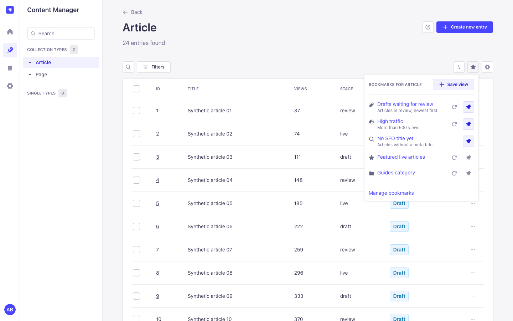
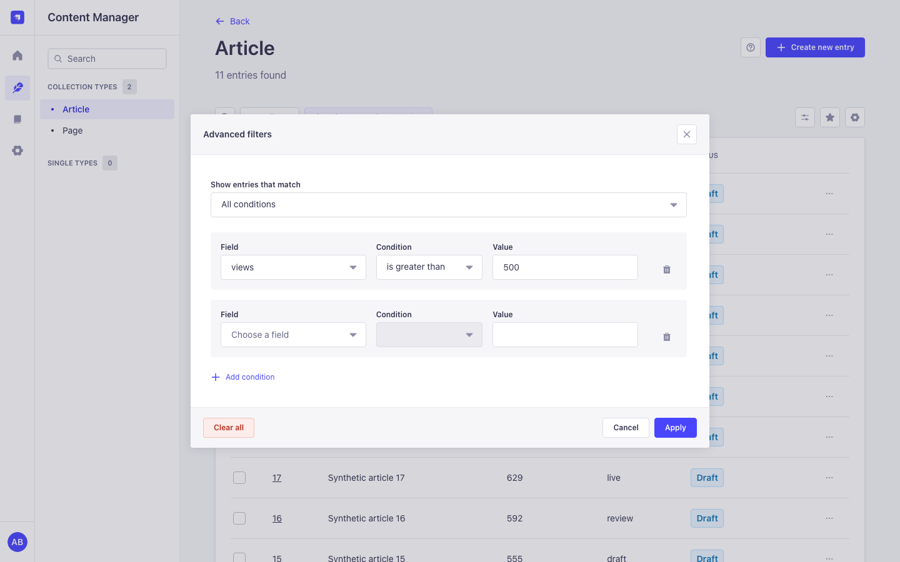
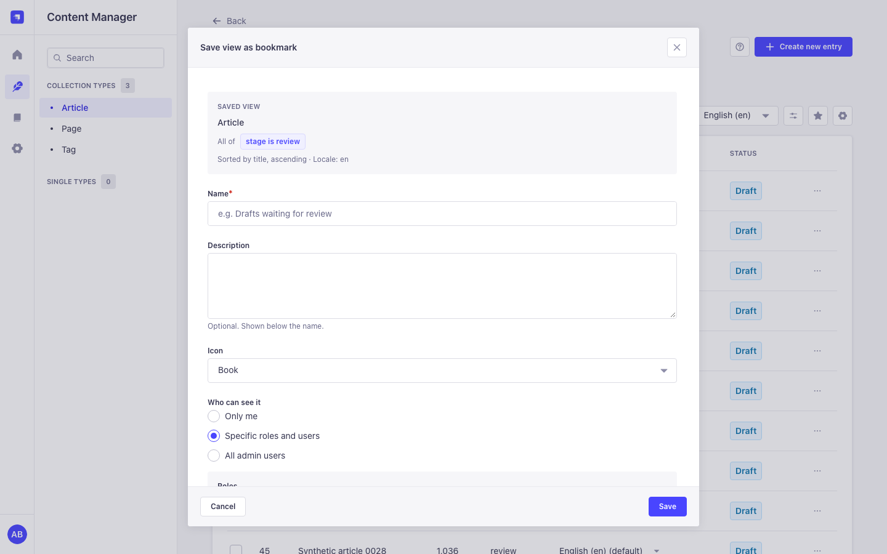
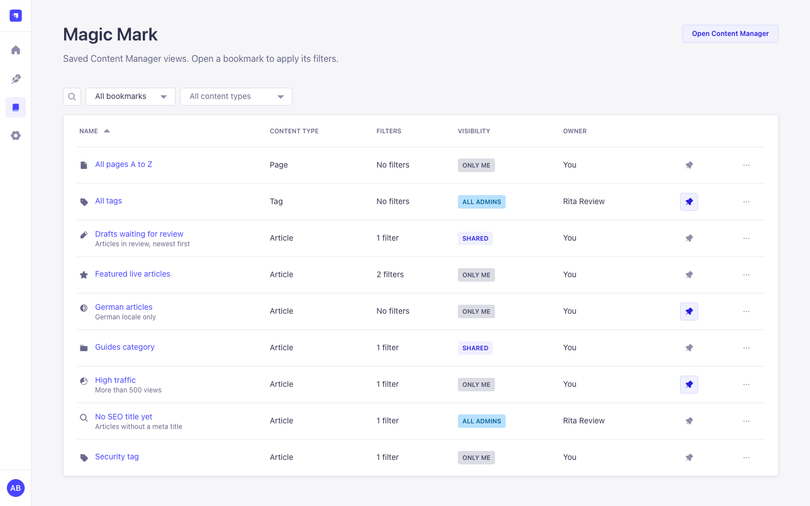
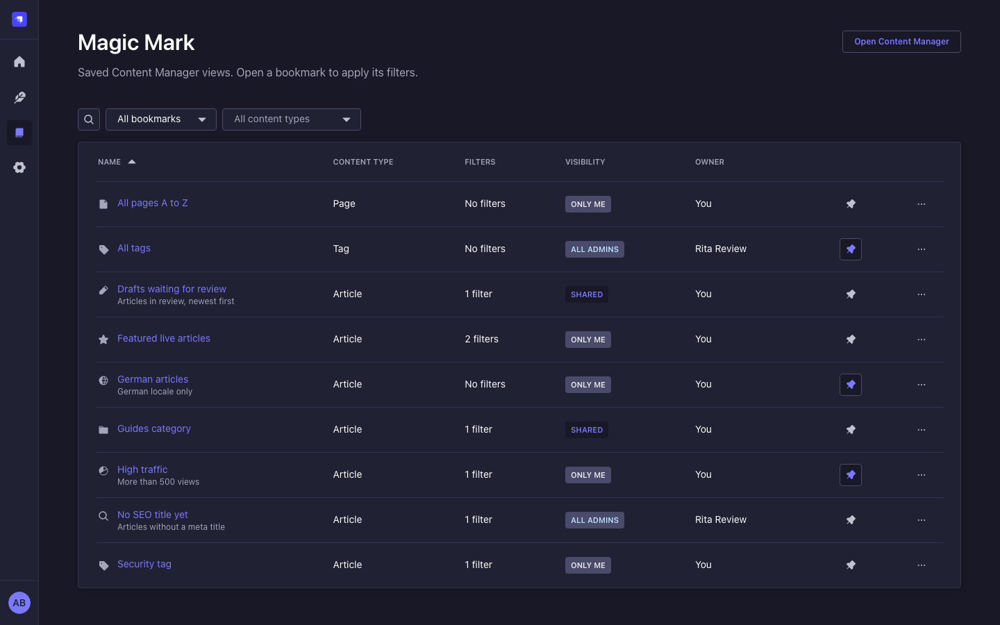
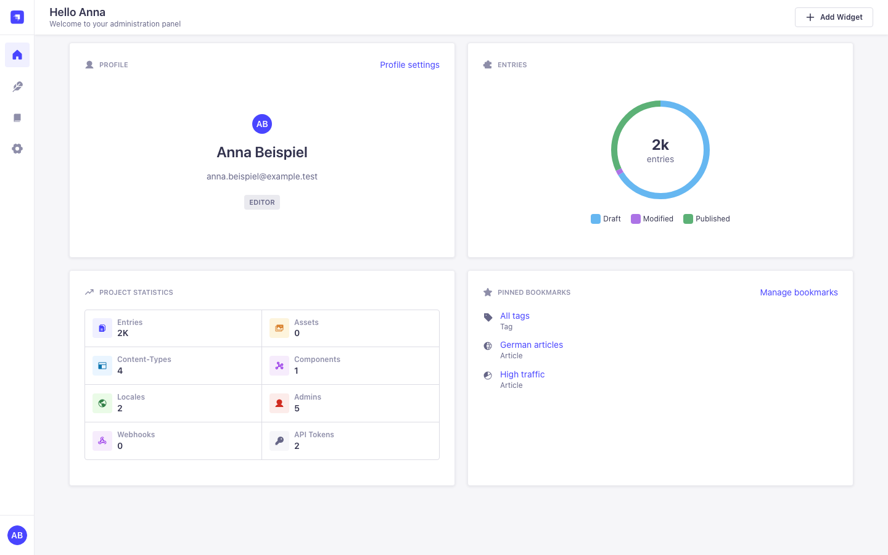
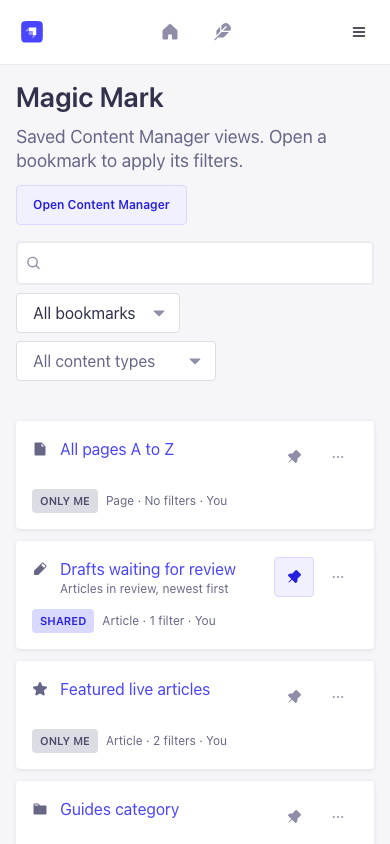

# Magic Mark

Bookmarks and advanced filters for the Strapi 5 Content Manager. Filter a list, save the view as
a bookmark, open it again with one click and share it with roles or individual admin users.

Free and open source (MIT). No license key, no limits, no tracking, no calls to external
servers.

[](https://www.npmjs.com/package/strapi-plugin-magic-mark)
[](https://github.com/Schero94/Magicmark/actions/workflows/test.yml)
[](./LICENSE)

Documentation site: [https://schero94.github.io/Magicmark/](https://schero94.github.io/Magicmark/)

## Contents

- [Screenshots](#screenshots)
- [Core concepts](#core-concepts)
- [Screens](#screens)
- [Compatibility](#compatibility)
- [Install](#install)
- [Configuration](#configuration)
- [Admin API and permissions](#admin-api-and-permissions)
- [Security and privacy](#security-and-privacy)
- [Troubleshooting](#troubleshooting)
- [Upgrading from 3.x](#upgrading-from-3x)
- [Development and tests](#development-and-tests)
- [Maintenance status](#maintenance-status)
- [Languages](#languages)
- [License](#license)

## Screenshots

All screenshots use synthetic data on an isolated Strapi 5.61 host.

### Bookmarks in the Content Manager



### Advanced filters



### Save view as bookmark



### Bookmarks page





### Homepage widget



### Mobile (390 px)



## Core concepts

| Term             | Meaning                                                                                                                                                                      |
| ---------------- | ---------------------------------------------------------------------------------------------------------------------------------------------------------------------------- |
| Bookmark         | A saved Content Manager list view: content type, filters, sort order, page size, search text and locale. The page number is not saved, so a bookmark always opens on page 1. |
| Owner            | The admin user who created the bookmark. Only the owner, or a user with **Manage shared bookmarks of others**, can edit or delete it.                                        |
| Visibility       | **Only me**, **Specific roles and users** or **All admin users**. Recipients can open, pin and duplicate a bookmark, but not change it.                                      |
| Pin              | Per user. Pinning a shared bookmark changes only your own list and your homepage widget.                                                                                     |
| Advanced filters | A filter editor for the list view with "all conditions" or "any condition", extra operators (is one of, is none of, is between), relation fields and component fields.       |

## Screens

| Screen                         | Where                                                                                                                                                                                                                                       | Who                                       |
| ------------------------------ | ------------------------------------------------------------------------------------------------------------------------------------------------------------------------------------------------------------------------------------------- | ----------------------------------------- |
| **Advanced filters** button    | Content Manager list view toolbar, next to View settings                                                                                                                                                                                    | Every admin who can open the list         |
| **Bookmarks** button (popover) | Same toolbar. Lists the bookmarks of this content type, pinned first (up to 100; a link opens the rest on the Magic Mark page). **Save view** captures the current list; the refresh icon saves the current view into an existing bookmark. | Read bookmarks (saving: Create bookmarks) |
| **Magic Mark** page            | Main menu. Search, show "created by me", "shared with me" or "pinned", filter by content type, sort and paginate. Row actions: pin, open, edit, duplicate, copy link, delete.                                                               | Read bookmarks                            |
| **Pinned bookmarks** widget    | Strapi homepage (Add widget)                                                                                                                                                                                                                | Read bookmarks                            |

Opening a bookmark is a normal in-app navigation (no page reload). The Content Manager's
remembered list settings for that content type are replaced by the bookmark's, so filters from
an earlier visit do not mix in.

With **All conditions** the filters use the same `$and` shape as Strapi's own filters, so they
appear as native filter tags and can be removed one by one. With **Any condition** the list is
filtered correctly, but Strapi does not show those conditions as tags; open Advanced filters to
change or clear them.

## Compatibility

| Plugin                     | Strapi            | Node.js               | Notes                                                                                                       |
| -------------------------- | ----------------- | --------------------- | ----------------------------------------------------------------------------------------------------------- |
| Next release (this branch) | 5.57 or newer 5.x | ^22.22.2 or >=24.15.0 | Acceptance host: Strapi 5.61.0 with SQLite. Free; 3.x data and permissions are migrated on the first start. |
| 3.x                        | 5.x               | 22                    | Contained the license system; no longer maintained.                                                         |

React 18, React Router 6, styled-components 6 and react-intl 6 are peer dependencies because the
Strapi 5 admin ships these majors. TypeScript stays on 5.9 for development because
`@strapi/sdk-plugin` 6.1.1 builds with TypeScript 5.9.3 and typescript-eslint 8 supports
TypeScript below 6.1.

## Install

```bash
npm install strapi-plugin-magic-mark
```

```js
// config/plugins.js (or .ts)
module.exports = () => ({
  'magic-mark': { enabled: true },
});
```

```bash
npm run build
npm run develop
```

Then give your roles the permissions they need under **Settings > Roles > Plugins > Magic
Mark**. Super Admins have all of them.

## Configuration

Magic Mark has no configuration options and reads no environment variables. Everything is
controlled with role permissions.

## Admin API and permissions

All routes are admin routes under `/magic-mark`. Each one requires an authenticated admin
(`admin::isAuthenticatedAdmin`) and every listed action (`admin::hasPermissions`). Owner checks
run in the service: a bookmark you cannot see answers `404`, a bookmark you can see but do not
own answers `403`.

| Permission (Settings > Roles > Plugins)       | Action id                             |
| --------------------------------------------- | ------------------------------------- |
| Read bookmarks                                | `plugin::magic-mark.bookmarks.read`   |
| Create bookmarks                              | `plugin::magic-mark.bookmarks.create` |
| Edit own bookmarks                            | `plugin::magic-mark.bookmarks.update` |
| Delete own bookmarks                          | `plugin::magic-mark.bookmarks.delete` |
| Share bookmarks                               | `plugin::magic-mark.bookmarks.share`  |
| Manage shared bookmarks of others (see below) | `plugin::magic-mark.bookmarks.manage` |

**Manage shared bookmarks of others** is meant for the people who keep the bookmark list tidy.
It covers every bookmark that is not private: public ones, ones shared with any role or user
(also when you are not a recipient) and ones whose owner was deleted. They are listed on the
Magic Mark page under **Show > All shared bookmarks**. Private bookmarks of other users stay
private, also for managers and Super Admins. Editing and deleting still need Edit own and
Delete own bookmarks.

| Method and path                 | Required actions | Notes                                                                                                                                                                                |
| ------------------------------- | ---------------- | ------------------------------------------------------------------------------------------------------------------------------------------------------------------------------------ |
| `GET /bookmarks`                | read             | Query: `page`, `pageSize` (max 100), `q`, `scope` (`all`, `mine`, `shared`, `pinned`, `managed`), `sort` (`name:asc`, `name:desc`, `updatedAt:desc`, `updatedAt:asc`), `contentType` |
| `POST /bookmarks`               | read, create     | Body: `name`, `path`, `query`, `description`, `icon`, `visibility`, `roles`, `users`. Sharing also needs share.                                                                      |
| `GET /bookmarks/:id`            | read             | Owners and managers also get the sharing lists                                                                                                                                       |
| `PUT /bookmarks/:id`            | read, update     | Owner or manage                                                                                                                                                                      |
| `DELETE /bookmarks/:id`         | read, delete     | Owner or manage                                                                                                                                                                      |
| `PUT /bookmarks/:id/view`       | read, update     | Replaces the saved query ("update with current view")                                                                                                                                |
| `POST /bookmarks/:id/duplicate` | read, create     | Private copy owned by the caller                                                                                                                                                     |
| `PUT /bookmarks/:id/pin`        | read             | Body `{ "pinned": true }`; per user                                                                                                                                                  |
| `GET /sharing/roles`            | share            | `documentId` and name                                                                                                                                                                |
| `GET /sharing/users`            | share            | Search `q`, `page`; 20 per page; email only with `admin::users.read`                                                                                                                 |

Errors follow Strapi's format `{ data: null, error: { status, name, message, details } }`.
Invalid input answers `400 ValidationError` with field details.

There are no Content API routes.

## Security and privacy

- No license system, no outbound requests, no timers and no telemetry. On the first start the
  3.x license keys are deleted from the plugin store.
- Every route checks permissions on the server; the menu and buttons only follow them.
- `path` must be a Content Manager list view (`/content-manager/collection-types/<uid>`), so a
  shared bookmark cannot send anyone to another admin page or off-site. Queries are parsed with
  `qs` with prototype keys disabled, limited in size and depth, and stored without `page`.
- Request bodies are validated with strict zod schemas; unknown fields are rejected.
- Recipients never see who else a bookmark is shared with. The user search returns names only,
  plus email for admins who may read admin users.
- Deleting an admin user removes their pins, the shares that point at them and their private
  bookmarks. Their public or shared bookmarks stay and show "Deleted user"; someone with
  **Manage shared bookmarks of others** finds them under **All shared bookmarks** and can edit or
  delete them. Deleting a role removes its shares.
- Logs contain no keys, emails or request bodies.
- Several Strapi processes can share one database: the plugin keeps no state in memory, lists
  are filtered and paginated in the database, and migrations claim each row with a guarded update
  inside a transaction.

## Troubleshooting

| Symptom                                       | Cause and fix                                                                          |
| --------------------------------------------- | -------------------------------------------------------------------------------------- |
| No Magic Mark menu entry or Bookmarks button  | The role lacks **Read bookmarks**.                                                     |
| Save view is missing                          | The role lacks **Create bookmarks**.                                                   |
| No sharing options in the dialog              | The role lacks **Share bookmarks**.                                                    |
| Users are listed without email                | Email is shown only to admins who can read admin users.                                |
| Advanced filters show only a few fields       | The role can read only those fields of the content type in the Content Manager.        |
| "This bookmark does not point to a list view" | The bookmark was saved by 3.x with an unusual path. Delete it and save the view again. |

## Upgrading from 3.x

No manual steps. On the first start after the upgrade:

- Roles with the 3.x permission **Read** (`settings.read`) get **Read bookmarks**. Roles with
  **Edit** (`settings.update`) get Read, Create, Edit own, Delete own and Share bookmarks. Strapi
  then removes the old permissions.
- Bookmarks shared with users or roles move to the new share table. Shares to users that no
  longer exist are dropped. Relative 3.x paths are fixed.
- A bookmark pinned in 3.x stays pinned for its owner. Pins are per user from now on.
- The custom order (move up and down) is gone; lists are sorted by name or by last update.
- The license key and its validation date are deleted. The Upgrade and License settings pages are
  gone; every feature is available to everyone.
- The 3.x icon ids are kept and shown with Strapi icons.

## Development and tests

```bash
npm ci --legacy-peer-deps
npm run lint
npm run format:check
npm test
npm run test:ts:front
npm run test:ts:back
npm run build
npm run verify
npm run verify:runtime
```

`npm test` runs the Node test runner over the server services, validation, routes (with the real
`admin::hasPermissions` policy), lifecycles and migrations, the admin filter and list view
helpers, translation completeness and source rules. Releases use semantic-release from `main`;
commit messages follow Conventional Commits.

## Maintenance status

Actively maintained. Dependabot proposes updates weekly; patch and minor updates are merged
after lint, tests, type checks, build and verify pass. Strapi peer majors are updated by hand.

## Languages

English, German, French, Spanish and Portuguese.

## License

[MIT](./LICENSE)
